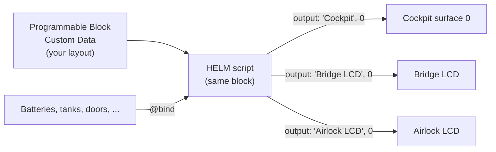

## 1. Prerequisites

Before installing HELM Core:
- Ensure **In-Game Scripts** are enabled in your Space Engineers world settings:
  `World Settings -> Advanced -> Enable In-Game Scripts [x]`.
- Have at least one **Programmable Block** and at least one **Text Panel** or cockpit surface on your grid.

## 2. How HELM Is Organized

HELM is configured in one place: the **Custom Data of the Programmable Block that runs the script**. The screens it draws on are only targets. They need no script and no configuration of their own.



- **Do not** put a script on each LCD or cockpit, and do not paste a layout into an LCD's own Custom Data. HELM ignores it.
- **Do** give each screen block a name, and use that name in `output:`. HELM switches the surface to script mode itself.
- One Programmable Block can drive many screens. Add one `@screen` per display to the same Custom Data.
- `@bind` lines connect names in your layout to real blocks or groups on the grid.

## 3. Installing the Script

1. Build or locate a **Programmable Block** on your grid.
2. Open its terminal interface and click **Edit Code**.
3. Select everything in the editor and replace it with the contents of **`HelmCombined.min.cs`** (under 100,000 characters, the Programmable Block limit). `HelmCombined.cs` is the same script with comments for reading; it is too long to paste.
4. Click **Check Code**.
5. Click **OK** and ensure the Programmable Block is powered **ON**.

```
[Programmable Block] -> Edit -> Paste -> Check Code -> OK
```

## 4. Configuring Custom Data

HELM Core reads its display configuration directly from the Programmable Block's **Custom Data** field.

1. Open the Programmable Block in the terminal.
2. Click **Custom Data** in the lower-right panel.
3. Paste a layout configuration (for example, our [Survival Essentials](/docs/presets-gallery/#survival-essentials) preset):

```helm
# Bind hardware terminal blocks
@bind batt  = battery("Battery")
@bind o2    = gastank("Oxygen Tank")
@bind h2    = gastank("Hydrogen Tank")
@bind cargo = cargo("Large Cargo")

# Define target screen
@screen MainCockpit
output: "Cockpit", 0
profile: CockpitSmall
layout: grid(2, 2)
bg: #090b0f
border_color: #38bdf8

# Top-Left: Power Reserves
@panel POWER at(0, 0, 1, 1) title: "POWER"
line: "BATTERY " bar(batt.percent) gradient(#38bdf8, #818cf8)

# Top-Right: Life Support
@panel LIFE at(1, 0, 1, 1) title: "LIFE SUP"
line: "O2 TANK " bar(o2.percent) flat(#06b6d4)
line: "H2 TANK " bar(h2.percent) flat(#eab308)

# Bottom-Left: Cargo
@panel CARGO at(0, 1, 1, 1) title: "STORAGE"
line: "CARGO   " bar(cargo.percent) flat(#94a3b8)
```

4. Click **OK** to save the Custom Data.
5. In the terminal, click **Run** (with argument `reload` or empty).

HELM will detect the changes, compile the AST, bind to matching grid blocks, and begin rendering immediately.

## 5. Setting Up Target Screens

The `output:` directive specifies where the layout renders:

```helm
output: "<Block Name>", <surface_index>
```

- **Stand-alone LCD Panels**:
  - `output: "LCD Panel Front", 0`
- **Cockpits & Flight Seats**:
  - `output: "Fighter Cockpit", 0` (Primary center screen)
  - `output: "Fighter Cockpit", 1` (Left instrument screen)
  - `output: "Fighter Cockpit", 2` (Right instrument screen)
- **Large Bridge Displays**:
  - `output: "Wide LCD Bridge Center", 0`

> **Tip:** You can declare multiple `@screen` blocks in Custom Data to power 10+ different LCDs from a single Programmable Block!

## 6. Verify & Troubleshoot

Open the Programmable Block terminal. The output pane shows one line per run, with the screen that was drawn, the instruction count and the run time (example values):

```text
HELM [SurvivalCockpit] instr 1234/50000 — 0.2ms
```

If a block is missing or renamed, HELM does not crash. The value of the affected gauge shows a red `ERR`, and the problem is listed in the Programmable Block's output pane on every run:

```text
HELM: output block 'Cockpit' not found
```

Configuration errors (a misspelled directive, a bad number) are listed the same way, with the line they came from.

### Common First-Time Mistakes

| Symptom | Cause | Fix |
| :--- | :--- | :--- |
| Nothing changes on the screen | The layout was pasted into the LCD's Custom Data | Paste it into the Programmable Block's Custom Data |
| `output block '...' not found` | No block on your ship has a name containing the `output:` text (a docked ship's blocks are ignored) | Rename the block or fix the `output:` text; use a name that only one block contains |
| A cockpit shows nothing on one screen | Wrong surface number | Cockpit surfaces are numbered from 0; try `output: "Cockpit", 1` |
| Gauges show `ERR` | An `@bind` name matches no block | Check the block or group name, or run `scan` to see which binds matched nothing |
| Layout edits take a moment to appear | The script re-reads Custom Data on its next run, about two seconds later | Run the block with argument `reload` to apply them at once |
| Check Code reports errors | The editor still contains part of the old script | Select everything in the editor and replace it with `HelmCombined.min.cs` |

### Common Commands

You can run these commands from a timer block, sensor, or cockpit hotbar:

| Argument | Action |
| :--- | :--- |
| `reload` | Re-parses Custom Data and rebuilds screen ASTs. |
| `refresh` | Re-resolves block names and screen surfaces without re-parsing. |
| `boot` | Plays the boot sequence again on every screen. |
| `scan` (also `diagnose`, `test`) | Prints a diagnostic report of binds, surfaces and instruction use. |
| `alert red` (also `on`) | Turns on the flashing red alert across all screens. |
| `alert off` | Clears the alert state. |
| `alert toggle` | Flips the alert state. |
| `set <var> <val>` | Sets an in-memory dynamic telemetry variable. |

Next, explore the [DSL Syntax Specification](/docs/dsl-syntax/) to customize panels and gauges.
