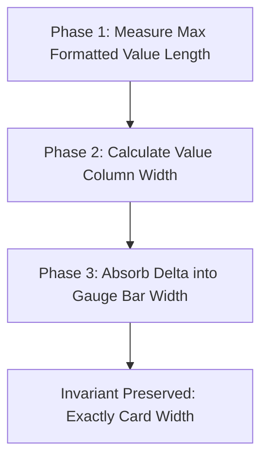

## 1. Unit Modes

HELM supports three unit display modes:

| Mode | Command Flag / Directive | Behavior |
| :--- | :--- | :--- |
| **Auto** | Default | Honors explicit `unit(...)` directives in layout lines; defaults others to percentage. |
| **Measurement** | `-Measurement` / `-Units` | Forces real-world engineering units across all block metrics based on hardware semantics. |
| **Percent** | `-Percent` | Forces pure percentage readouts (`xx.x%`) across all lines, even those with `unit(...)`. |

---

## 2. Engineering Measurement Scaling

When measurement mode is active, HELM scales raw values according to typical Space Engineers magnitudes:

| Block Domain | Magnitude / Threshold | Formatted Output | Example |
| :--- | :--- | :--- | :--- |
| **Nuclear Reactors** | `>= 1000 MW` | `GW` (1 decimal) | `1.42 GW` |
| **Power Grids & Batteries** | `< 1000 MW` | `MW` (1 decimal) | `24.8 MW` |
| **Solar & Wind Turbines** | `< 1 MW` | `kW` (0 decimals) | `420 kW` |
| **Gas Tanks & Cargo** | `kL` (kilolitres) | `kL` (0 decimals) | `160 kL` |
| **Atmospheric Pressure** | `kPa` (kilopascals) | `kPa` (0 decimals) | `101 kPa` |
| **Ship Velocity** | `m/s` (meters / second) | `m/s` (1 decimal) | `104.4 m/s` |
| **Sensor & Weapon Range** | `>= 1000 m` | `km` (1 decimal) | `2.4 km` |
| **Sensor & Weapon Range** | `< 1000 m` | `m` (0 decimals) | `850 m` |
| **Turret Ordnance** | Count | `rds` (rounds) | `480 rds` |
| **Gyros & Avionics** | Angle | `°` or `deg` (1 decimal) | `-12.5°` |
| **Rotors & Machinery** | Velocity | `RPM` (1 decimal) | `30.0 RPM` |

---

## 3. Dynamic 3-Phase Alignment Engine

In fixed-width terminal layouts, a value changing from `98%` (3 chars) to `1.42 GW` (7 chars) or `104.4 m/s` (9 chars) would ordinarily push right borders outward and tear the display.

HELM Core avoids this with a **3-phase pre-scan dynamic alignment engine**:

### Invariant
The total card width is mathematically preserved across every line:
$$\text{Border Left (2)} + \text{Label (8)} + \text{Sep (1)} + \text{Gauge Width} + \text{Sep (1)} + \text{Value Width} + \text{Border Right (2)} = \text{Card Width}$$

If the value column needs 9 characters for `104.4 m/s`, the gauge bar width automatically shrinks by 2 characters, keeping the outer border aligned.

---

## 4. Live Hotkey Switching in `helmv`

When running the interactive terminal visualizer (`helmv.ps1`), you can toggle units live with single keypresses:

- **`M`**: Switch to Measurements mode.
- **`P`**: Switch to Percentage mode.
- **`U` / `Tab` / `Space`**: Cycle between Auto, Measurements, and Percentage.
- **`Q`**: Exit visualizer.
